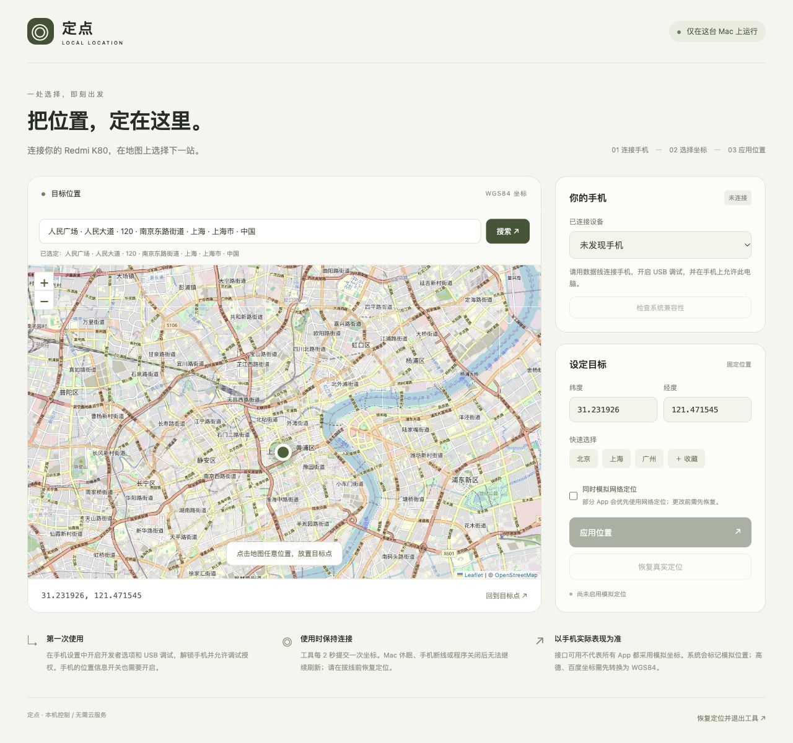

# 定点 · Mac 本地 Android 模拟定位工具

在 Mac 浏览器中选择目标位置，通过 USB 连接的 Android 手机应用模拟定位。适合个人开发、地图功能调试和位置相关场景测试。

**一次启动，网页操作。** 手机无需安装本工具的 App，也无需 Root；使用期间需要保持 Mac 程序运行和手机连接。仓库名称中的 `IP-change` 指这个项目，工具实际修改的是定位坐标，**不会改变网络出口 IP**。



## 目录

- [功能与适用范围](#功能与适用范围)
- [安装与首次启动](#安装与首次启动)
- [连接手机与日常使用](#连接手机与日常使用)
- [地图与坐标](#地图与坐标)
- [恢复定位与异常退出](#恢复定位与异常退出)
- [常见问题](#常见问题)
- [工作原理与本地数据](#工作原理与本地数据)
- [开发与接口](#开发与接口)
- [依赖与参考](#依赖与参考)

## 功能与适用范围

| 功能 | 说明 |
| --- | --- |
| 地图选点、手动输入坐标 | 按 WGS84 纬度、经度选择目标位置 |
| 固定位置模拟 | 应用后每 2 秒向手机刷新坐标，可随时更新目标位置 |
| GPS / 网络定位源 | 默认模拟 `gps`，可选同时模拟 `network` |
| 设备状态与兼容性检查 | 展示连接状态，读取系统信息并检查测试定位接口 |
| 快捷位置与收藏 | 提供城市参考点，浏览器本地最多保存 8 个收藏 |
| 恢复真实定位 | 清理本工具创建的测试定位源，还原原有模拟定位权限 |
| 异常恢复记录 | 断线或异常退出后保留记录，重新连接原手机继续恢复 |

| 环境 | 要求与当前状态 |
| --- | --- |
| Mac | 提供 Apple 芯片（arm64）和 Intel（amd64）构建；当前启动器面向 macOS |
| Android 手机 | 需要 USB 调试授权、开启位置信息，且系统允许 ADB 测试定位操作 |
| Redmi K80 / HyperOS | 目标适配设备；目前尚未完成真机验证，支持情况以实际检查和应用结果为准 |
| 运行依赖 | 构建后的程序 + Mac 版 Android SDK Platform-Tools；不需要 Android Studio |
| 构建依赖 | Go 1.23 或更新版本；只在从源码构建时需要 |
| 网络 | 地图瓦片需要联网；手动输入坐标和 ADB 控制可离线使用 |

兼容性检查通过只代表系统提供相关接口，不能证明系统允许注入坐标。部分 App 使用融合定位、网络信息或缓存，也可能拒绝模拟位置；请在目标 App 中核对实际效果。当前版本提供固定位置模拟，未提供路线或连续移动模拟。

## 安装与首次启动

**当前仓库提供源码，尚未发布可直接下载的安装包。** GitHub 的 “Download ZIP” 和 `git clone` 均不包含两种 Mac 启动程序，也不包含 `platform-tools/`；需要完成以下准备后才能双击启动。

### 1. 获取源码

```sh
git clone https://github.com/Yuanmy621/mac-IP-change.git
cd mac-IP-change
```

也可以在仓库页面选择 **Code → Download ZIP**，解压后在终端进入项目文件夹。

### 2. 准备 Go 和 ADB

1. 按 [Go 官方安装说明](https://go.dev/doc/install) 安装 Go 1.23 或更新版本。终端执行 `go version` 确认安装成功。
2. 从 [Android SDK Platform-Tools 官方下载页](https://developer.android.com/tools/releases/platform-tools) 选择 **Mac** 版本。
3. 解压下载文件，把完整的 `platform-tools` 文件夹放进项目根目录。确认存在 `platform-tools/adb`。

无需安装完整的 Android Studio。请保留下载包中的 `NOTICE.txt` 等第三方声明。

### 3. 构建并启动

在项目根目录运行：

```sh
./build.sh
```

构建脚本会生成两个 Mac 程序，并设置启动器和 ADB 的执行权限。文件布局应类似：

```text
mac-IP-change/
├── 启动定点.command
├── 定点-Apple芯片          # 构建生成
├── 定点-Intel芯片          # 构建生成
├── platform-tools/        # 手动下载并解压
│   ├── adb
│   └── NOTICE.txt
├── web/                   # 构建时嵌入程序的网页资源
└── .runtime/              # 首次启动后生成的恢复记录目录
```

双击 **`启动定点.command`**。启动器自动选择对应芯片的版本，并打开默认浏览器。以后使用只需再次双击，无需重复构建；更新源码中的服务或网页后需要重新构建。

构建后的程序运行时不需要 Go 或 Node。当前程序没有 Apple 开发者签名或公证；如果 macOS 提示无法打开，请先确认下载来源，再按 [Apple 官方说明](https://support.apple.com/zh-cn/102445) 在“隐私与安全性”中处理。

## 连接手机与日常使用

### 首次连接手机

1. 在手机设置中开启开发者选项，再开启 **USB 调试**。不同 HyperOS 版本的菜单名称可能不同，可在设置中搜索；一般 Android 配置可参考 [官方开发者选项说明](https://developer.android.com/studio/debug/dev-options)。
2. 开启手机的 **位置信息**，使用支持数据传输的 USB 线连接 Mac。
3. 解锁手机，在 USB 调试授权提示中允许此电脑。
4. 网页显示“已连接”后选择手机，点击 **“检查系统兼容性”**，阅读实际检查结果。

### 应用与更新位置

1. 在地图上点击目标位置，或填写纬度、经度。
2. 如需同时模拟网络定位，先勾选对应选项。
3. 点击 **“应用位置”**。成功后工具持续刷新坐标；在手机上的目标 App 中确认位置。
4. 选择新的目标点，再点击 **“更新目标位置”**即可更换坐标。
5. 更换手机或定位源前，先点击 **“恢复真实定位”**。

### 结束使用

保持手机连接，点击页面底部的 **“恢复定位并退出工具”**。确认恢复成功后，再拔线或关闭网页。

关闭浏览器标签页不会停止后台工具。Mac 休眠、关机或 USB 断开后，工具无法继续刷新位置，也不能保证即时清理手机上的模拟定位。

默认网页地址为 `http://127.0.0.1:8765`。请使用启动器自动打开的页面：其中包含每次启动生成的随机会话凭证，同一标签页刷新会保留凭证。手动打开裸地址、换浏览器或打开新标签页可能提示会话过期；正常退出工具后重新启动即可打开新会话。

## 地图与坐标

地图使用 Leaflet 和 OpenStreetMap。网络不可用时可继续手动填写坐标；地图瓦片无法加载并不代表手机连接失败。

输入顺序是 **纬度在前，经度在后**：

| 示例位置 | 纬度 | 经度 |
| --- | --- | --- |
| 上海参考点 | `31.2304` | `121.4737` |
| 北京参考点 | `39.9042` | `116.4074` |
| 广州参考点 | `23.1291` | `113.2644` |

纬度范围为 `-90～90`，经度范围为 `-180～180`。工具按 **WGS84** 处理，不自动转换坐标系。高德的 GCJ-02 或百度的 BD-09 坐标需要先转换，否则可能出现偏移；城市快捷按钮只是参考点。

点击“收藏此位置”可保存当前坐标，最多保留 8 个。收藏保存在当前浏览器的本地存储中；点击收藏可选定坐标，按住 **Option** 点击可删除。清理浏览器数据会移除收藏。

## 恢复定位与异常退出

正常恢复时，工具先移除自己创建的测试定位源，再还原模拟前 ADB shell 的模拟定位权限。工具不会主动修改手机的全局位置信息开关。真实位置重新显示可能需要等待下一次系统定位，请在手机上确认。

如果断线或异常退出后提示“存在待恢复会话”：

1. 保留原项目文件夹中的 **`.runtime/session.json`**，不要删除恢复记录。
2. 重新连接并授权 **原来的手机**。
3. 启动工具，点击 **“恢复真实定位”**。
4. 恢复成功后，再开始新的模拟定位会话。

工具重启后不会自动继续上次的坐标刷新，而是要求先恢复。恢复失败时，记录会保留；通过网页退出时，如果手机未恢复，程序会继续运行并提示重试。在终端按 **Control+C** 或收到正常终止信号时，程序也会尝试恢复，但强制结束、断电或手机断线无法保证恢复成功。

程序会拒绝已检测到的现有模拟定位源。请先退出其他模拟定位工具并恢复，避免多个工具同时控制同一定位源。

## 常见问题

| 现象 | 检查与处理 |
| --- | --- |
| “启动程序不存在” | 源码下载不包含可执行程序；先准备 `platform-tools/` 并运行 `./build.sh` |
| “找不到 ADB”或构建时找不到 `platform-tools/adb` | 检查是否下载了 Mac 版，以及解压后的完整文件夹是否放在项目根目录 |
| 提示 `Permission denied` | 在项目目录执行 `chmod +x build.sh 启动定点.command platform-tools/adb`，再重试 |
| 网页显示“未发现手机” | 换一条数据线或 USB 接口，确认 USB 调试开启；在手机上解锁并允许电脑 |
| “等待授权” / `unauthorized` | 检查手机上的 USB 调试授权弹窗；必要时撤销旧授权后重新连接 |
| `offline` / 手机响应超时 | 检查手机和数据线，重新连接并等待设备就绪，再重试；保留待恢复记录 |
| 系统拒绝权限或缺少测试定位接口 | 记录 Android / HyperOS 版本与页面错误；当前系统可能不支持此方式，工具会尝试回滚 |
| 坐标提交成功，但目标 App 位置没有变化 | 核对手机位置信息开关、坐标系和目标 App 缓存；可恢复后尝试同时模拟网络定位，仍需实际核对 |
| 会话过期 | 使用启动器自动打开的标签页；先正常退出已有工具，再重新启动 |
| “工具已经在运行” / 端口被占用 | 回到原工具页面恢复并退出；如果端口被其他程序使用，可用下方 `--port` 参数指定其他端口 |
| 恢复失败 | 连接并授权原手机，保留 `.runtime`，再次点击恢复；恢复成功后再拔线 |
| 修改了网页源码，启动后还是旧界面 | 网页资源嵌入二进制；重新构建，再退出旧进程并启动新程序 |

可在项目目录用只读命令检查 ADB 连接状态：

```sh
./platform-tools/adb devices -l
```

反馈问题时，请在 [Issues](https://github.com/Yuanmy621/mac-IP-change/issues) 中提供 Mac 芯片类型、手机型号、Android / HyperOS 版本、操作步骤和完整错误文字。分享截图或日志前移除设备序列号、私人坐标及会话凭证。

## 工作原理与本地数据


网页本身不能直接修改 Android 系统定位。程序通过 ADB 操作 Android 的测试定位源，系统会为这些坐标添加模拟位置标记；本工具不绕过 App 的模拟定位检测。

服务只监听 Mac 的 `127.0.0.1`，使用随机会话凭证校验接口，并检查 Host 和 Origin。当前版本在 **Mac 浏览器**操作，手机浏览器无法访问 Mac 的回环地址。无需账号、云服务器或数据库，也无需开放公网端口。

| 数据 | 保存位置与用途 |
| --- | --- |
| 会话凭证 | 自动打开页面的 URL 片段，随后转存当前标签页的 `sessionStorage`，用于本机接口验证 |
| 收藏坐标 | 浏览器 `localStorage`，供下次选点使用 |
| 恢复记录 | `.runtime/session.json`，包含设备序列号、目标坐标、创建的定位源和原权限状态，用于异常恢复 |
| 地图请求 | 浏览器向 OpenStreetMap 请求当前视野对应的地图瓦片 |

默认不在终端打印带凭证的完整 URL。不要分享完整会话地址，也不要在待恢复时移动或清空恢复记录。`.runtime/`、构建产物和下载的 `platform-tools/` 已被 Git 忽略。

## 开发与接口

服务端使用 Go 标准库，网页资源与 Leaflet 在构建时嵌入二进制。

| 文件 | 作用 |
| --- | --- |
| `main.go` | 本机 HTTP 服务、ADB 控制、会话恢复与设备检查 |
| `main_test.go` | 模拟设备与 HTTP 接口测试 |
| `web/` | HTML、CSS、JavaScript 与 Leaflet 资源 |
| `build.sh` | 构建两种 Mac 架构的程序 |
| `启动定点.command` | 自动选择芯片版本并启动 |

### 验证与构建

```sh
go test -race ./...
./build.sh
```

测试覆盖输入校验、权限拒绝、部分初始化失败回滚、断线与重启恢复、现有模拟定位保护、设备或定位源切换限制，以及接口访问限制。测试使用模拟设备，不会对手机应用模拟坐标，也不能替代真机兼容性验证。

### 命令行参数

| 参数 | 默认值 | 用途 |
| --- | --- | --- |
| `--port` | `8765` | 本机网页端口 |
| `--adb` | 程序旁的 `platform-tools/adb` | 指定 ADB 可执行文件 |
| `--state` | 程序旁的 `.runtime/session.json` | 指定恢复记录路径，后续恢复时应使用同一路径 |
| `--no-open` | `false` | 不自动打开浏览器 |
| `--print-url` | `false` | 在终端打印带会话凭证的完整 URL，仅供本机调试 |

Apple 芯片示例（Intel Mac 将程序名替换为 `定点-Intel芯片`）：

```sh
./定点-Apple芯片 --port 8876
./定点-Apple芯片 --adb /path/to/adb --no-open --print-url
```

### 本机 API

所有接口需要当前会话的 **`X-Session-Token`** 请求头。POST 请求还需要 `Content-Type: application/json`；以下示例中的设备序列号从状态接口获取。

| 方法与路径 | 请求体 | 作用 |
| --- | --- | --- |
| `GET /api/status` | 无 | 获取设备和当前会话状态 |
| `POST /api/probe` | `{"serial":"设备序列号"}` | 读取系统信息并检查接口 |
| `POST /api/location/set` | 见下方示例 | 应用坐标并开始持续刷新 |
| `POST /api/location/reset` | `{}` | 清理模拟定位并还原权限 |
| `POST /api/shutdown` | `{}` | 恢复成功后退出工具 |

位置请求示例：

```json
{
  "serial": "设备序列号",
  "latitude": 31.2304,
  "longitude": 121.4737,
  "network": false
}
```

`network: false` 使用 GPS 测试源；`true` 同时使用网络测试源。切换该选项前需先恢复已有会话。应用、恢复和退出成功时返回 `{"ok":true}`；操作错误返回包含 `error` 字段的 JSON，请读取 HTTP 状态和错误文字。

## 依赖与参考

- [Android SDK Platform-Tools](https://developer.android.com/tools/releases/platform-tools)：ADB 官方下载与发布说明；下载包中的第三方声明见 `platform-tools/NOTICE.txt`。
- [Android 测试定位命令源码](https://android.googlesource.com/platform/frameworks/base/+/android16-release/services/core/java/com/android/server/location/LocationShellCommand.java)：测试定位接口参考，设备实际支持情况以系统提供的命令为准。
- [Leaflet 1.9.4](https://leafletjs.com/download.html)：地图交互组件，许可证见 [Leaflet-LICENSE](web/vendor/Leaflet-LICENSE)。
- [OpenStreetMap](https://www.openstreetmap.org/copyright)：地图数据与瓦片，页面保留地图署名。

