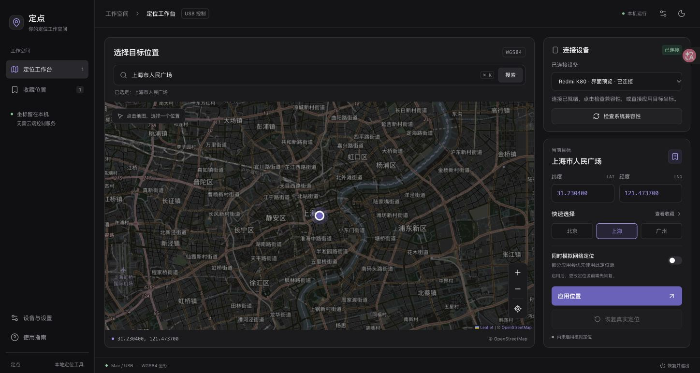
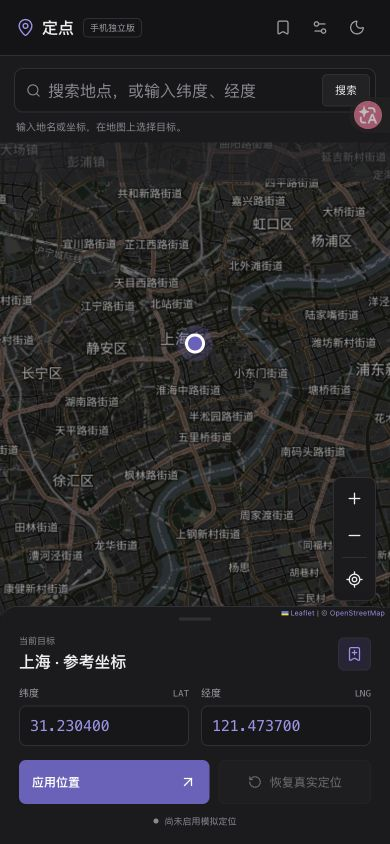
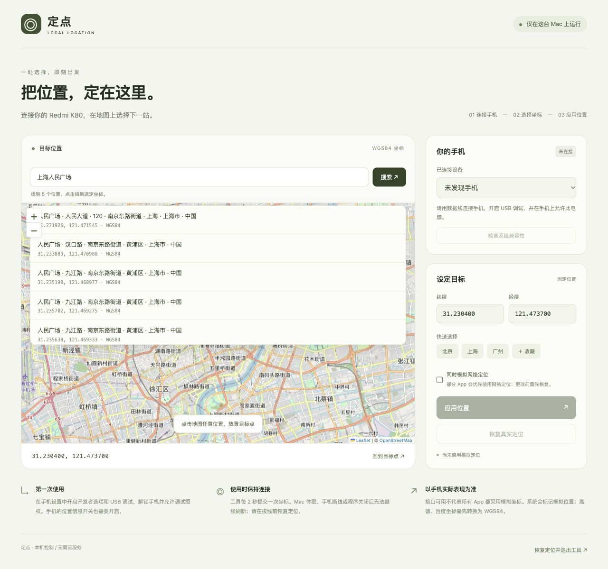

# 定点 · Android 模拟定位工具

在地图中选择位置，支持 **手机独立版** 和 **Mac + USB 版**。适合个人开发、地图功能调试和位置相关场景测试。

开发中的 v1.2.0 将 Android 配置流程推广到标准 Android 9+ 手机，并新增独立 **iOS 实验版**。当前公开 Release 仍为 v1.1.0。Android 使用统一 APK，无需按 Redmi、三星或其他品牌分别打包；只有 Redmi K80 完成过本项目实机验证。

| 平台 | 实现与验证状态 |
| --- | --- |
| Android 9+ | 原生前台服务 + 标准模拟位置接口；安装配置后可独立运行。新增精确权限、模拟位置应用、系统定位、通知和后台限制检查，以及通用设置入口。其他机型待验证。 |
| iPhone 16 及更新机型 / iOS 27+ | 独立 SwiftUI 实验客户端，本机配对 + LocalDevVPN + 开发者定位服务。可构建未签名 IPA，但未完成 iPhone 实机验证；签名安装、开发者镜像准备及后台保持存在限制，尚不能保证全过程无需电脑。 |
| Mac + Android / USB | 保留原有 ADB 控制方式；不依赖具体手机型号，受系统与厂商权限限制。 |

iOS 源码、构建方式与验收清单见 [iOS 实验版说明](ios/README.md)。`./build-ios.sh` 输出 `dist/定点-iOS-实验版-未签名.ipa`，需要自行签名侧载，不能直接点击安装。普通 iOS App 或网页没有修改整机定位的公开接口；实验版通过开发调试服务实现，不是 App Store 版。当前没有对最新 iOS 的后续更新作兼容保证。

**手机独立版：安装一次，之后通过链接打开。** 在 Android 手机上安装“定点”并将它选为模拟位置信息应用，之后可断开电脑，在手机中选点和恢复定位。原来的 Mac 版仍可使用，不需要在手机安装 App，但使用期间要保持电脑运行和 USB 连接。两种模式均无需 Root。仓库名称中的 `IP-change` 指这个项目，工具实际修改的是定位坐标，**不会改变网络出口 IP**。

**下载 [v1.1.0 Release](https://github.com/Yuanmy621/IP-change/releases/tag/v1.1.0)**：Android 使用 `dingdian-1.1.0-android.apk`；Mac 使用 `dingdian-1.1.0-macos.zip`，包含两种芯片的程序、启动器和 ADB。文件摘要见 `SHA256SUMS.txt`，版本说明见 [CHANGELOG.md](CHANGELOG.md)。

## 手机独立版

Android 9 及以上可安装；目前提供个人测试用 APK。网页地图、搜索与收藏界面打包在 App 内，由 Android 前台服务操作测试定位源，每 2 秒刷新一次。链接用于打开已安装的 App；普通浏览器本身无法修改系统定位。

首次使用：

1. 若正在使用 Mac 版，先连接原手机，在 Mac 页面恢复定位并退出工具。
2. 从 Release 下载并安装 Android APK（自行构建的输出为 `dist/定点-Android.apk`），打开“定点”，允许精确位置信息和通知，并开启手机位置信息。
3. 在手机开发者选项中，将“定点”选为“模拟位置信息应用”。页面提供进入开发者选项的按钮。
4. 通过入口链接或桌面图标打开，选择目标点并点击“应用位置”。此后日常运行无需电脑或数据线。
5. 结束时从页面或通知栏点击“恢复真实定位”。恢复会移除本工具创建的测试定位源，保留你的模拟位置应用选择。

当前私人入口：[手机打开定点](https://dingdian-mobile-yuanmy.ymy17360692646.chatgpt.site)，需要登录入口所有者的 ChatGPT 账号，该入口仍保留早期测试包，升级请使用上方最新 Release。手机独立版使用 `dingdian://open` 启动链接；静态入口页源码在 `docs/`。点击链接不会自动应用坐标，仍需在 App 中确认。也可将 `docs/` 入口页托管在自己的 HTTPS 网站；页面已链接到最新 Release，可下载安装包和启动应用。内置浏览器可能限制唤起，请使用手机系统浏览器。

定位服务运行时显示持续通知。手机系统的后台限制可能停止服务，可在应用电量设置中允许持续运行。进程被终止或手机重启后不会自动续用旧坐标；重新打开 App 后先处理待恢复会话。存在恢复记录时不要清除应用数据或卸载。切换 Mac 版与手机独立版前，应先恢复并退出当前版本。

手机独立版已在 Redmi K80（Android 16 / HyperOS 3.0）验证链接唤起、网页提交坐标、GPS / 网络测试源、切到后台后的持续刷新，以及恢复清理。系统会标记模拟位置，目标 App 是否采用这些坐标仍需实际核对。地图瓦片和地名搜索需要网络，手动输入坐标与位置控制可离线运行。手机独立版不开放网络控制端口，链接不能远程提交坐标。

### 构建手机独立版

准备 JDK 17、Android SDK（Android 36 平台）并在 `android/local.properties` 填写 `sdk.dir=/你的/Android/SDK`，然后运行：

```sh
./build-android.sh
```

Gradle Wrapper 自动下载固定版本的 Gradle，并校验下载摘要；首次构建还需联网下载 Android 构建工具。APK 输出到 `dist/定点-Android.apk`。目前使用本机 Android 默认调试签名；如需持续升级已有安装，保留同一签名密钥。正式分发应使用自己的发布签名。

原生代码位于 `android/app/src/main/java/com/yuanmy/dingdian/`，复用 `web/` 静态资源。`native-bridge.js` 仅在安装版内连接受限的原生接口；普通 Mac 浏览器继续使用原来的本机 HTTP 接口。恢复记录保存在 App 私有数据中，禁止备份到云端或转移至其他手机。

### 手机端更新（从 v1.1.0 开始）

打开“设备与设置 → 应用更新”，点击“检查更新”。发现新版本后可查看说明、下载 APK，下载完成会校验文件摘要、包名、版本和签名。先恢复真实定位，再点击“安装更新”；首次需要在 Android 设置中允许“定点”安装应用，返回后再次点击安装，在系统安装页面确认即可。覆盖安装会保留收藏和设置，无需连接电脑。检查和下载期间可以继续使用当前版本；下载时请保持 App 打开，进程被终止后需重新检查并下载。

旧的 0.2.0 / 1.0.0 没有更新入口，需要从 Release 手动下载并覆盖安装一次带更新入口的版本，不要先卸载。更新必须使用与原安装相同的签名。

发布新版本时：

1. 在 `android/app/build.gradle` 更新 `versionName`（例如 `1.2.0`）与递增的 `versionCode`，并在 `CHANGELOG.md` 添加对应版本说明。
2. 使用原构建电脑的签名密钥运行 `python3 scripts/prepare-release.py`；同时发布 Mac 版可加 `--with-mac`；仅在明确接受实验状态时用 `--with-ios` 附带未签名 IPA（见 iOS 说明）。脚本构建 APK，检查签名，输出到 `dist/release-版本号/`。
3. 将源码改动提交并推送，用对应提交创建 GitHub Release（例如标签 `v1.2.0`），上传生成的 `dingdian-1.2.0-android.apk`、`update.json` 与 `SHA256SUMS.txt`；若打包了 Mac 版，再上传 ZIP。发布为正式版本并设为 Latest。
4. 手机上点击“检查更新”即可发现新版本。草稿和预发布版本不会作为正常升级入口；不要只上传 APK 或只改标签。

手机读取固定地址 `https://github.com/Yuanmy621/IP-change/releases/latest/download/update.json`，不需要 GitHub 账号或 API Token。它是 GitHub 支持的[最新 Release 资源链接](https://docs.github.com/en/repositories/releasing-projects-on-github/linking-to-releases)。网络无法访问 GitHub 时会显示重试提示，也可通过“查看 Release”手动下载。

`android/update-signing.sha256` 只记录已发布 APK 的公开证书摘要。当前沿用 v1.0.0 的本机调试签名：请妥善备份 `~/.android/debug.keystore`，不要提交密钥文件。换电脑时迁移同一密钥；随机生成新调试密钥或换成新发布密钥，都无法直接覆盖现有安装。打包脚本会拒绝不匹配的签名。

验证命令（手机测试需要连接已授权的 Android 设备）：

```sh
cd android
./gradlew :app:assembleDebug :app:assembleDebugAndroidTest
./gradlew :app:testDebugUnitTest # 更新清单、下载地址与版本规则，不需要连接手机
./gradlew :app:connectedDebugAndroidTest
```

`ControllerTest` 使用独立的恢复记录，覆盖无效坐标、异常恢复保护和损坏记录保留，不会注入测试位置。

另外提供显式启用的 `PhoneFlowTest`，通过 WebView 控制界面应用上海参考坐标，验证 GPS / 网络测试源、后台刷新和服务恢复。普通测试运行不会启用该流程。仅在已配置模拟位置授权、没有其他待恢复会话的测试手机上，安装应用和测试 APK 后执行：

```sh
adb shell am instrument -w -e exerciseMock true \
  -e class com.yuanmy.dingdian.PhoneFlowTest \
  com.yuanmy.dingdian.test/android.test.InstrumentationTestRunner
```

## 界面与主题

开发版采用 Linear 风格的中性灰阶与紫色强调色，支持深色、浅色和跟随系统。桌面提供侧栏、地图和右侧操作区；手机竖屏使用地图与底部面板，横屏将地图和操作区并排。手机授权设置收纳在右上角的设置中。

搜索支持地名、地址和坐标，桌面可按 `⌘K` / `Ctrl+K` 聚焦搜索框。收藏通过抽屉管理，并提供独立删除按钮。手机展开底部面板后可选择快捷城市及网络定位源，应用和恢复按钮保留在操作区。

以下为开发版界面预览（使用模拟设备），尚未发布到 v1.0.0 Release。设计参考、组件选型和维护方式见 [界面设计说明](docs/UI_DESIGN.md)。






## 目录

- [功能与适用范围](#功能与适用范围)
- [安装与首次启动](#安装与首次启动)
- [连接手机与日常使用](#连接手机与日常使用)
- [地图与坐标](#地图与坐标)
- [恢复定位与异常退出](#恢复定位与异常退出)
- [常见问题](#常见问题)
- [工作原理与本地数据](#工作原理与本地数据)
- [开发与接口](#开发与接口)
- [依赖与参考](#依赖与参考)

## 功能与适用范围

| 功能 | 说明 |
| --- | --- |
| 地图选点、手动输入坐标 | 按 WGS84 纬度、经度选择目标位置 |
| 坐标与地名搜索 | 经纬度在浏览器本地解析，地名或地址通过 Photon 查询 |
| 固定位置模拟 | 应用后每 2 秒向手机刷新坐标，可随时更新目标位置 |
| GPS / 网络定位源 | 默认模拟 `gps`，可选同时模拟 `network` |
| 设备状态与兼容性检查 | 展示连接状态，读取系统信息并检查测试定位接口 |
| 快捷位置与收藏 | 提供城市参考点，浏览器本地最多保存 8 个收藏 |
| 恢复真实定位 | 清理本工具创建的测试定位源，还原原有模拟定位权限 |
| 异常恢复记录 | 断线或异常退出后保留记录，重新连接原手机继续恢复 |

| 环境 | 要求与当前状态 |
| --- | --- |
| Mac | 提供 Apple 芯片（arm64）和 Intel（amd64）构建；当前启动器面向 macOS |
| Android 手机 | 需要 USB 调试授权、开启位置信息，且系统允许 ADB 测试定位操作 |
| Redmi K80 / HyperOS | Mac + USB 版及手机独立版均已在 Android 16 / HyperOS 3.0 上验证 GPS 与网络测试源；其他版本仍需核对实际效果 |
| 运行依赖 | 构建后的程序 + Mac 版 Android SDK Platform-Tools；不需要 Android Studio |
| 构建依赖 | Go 1.23 或更新版本；只在从源码构建时需要 |
| 网络 | 地图瓦片需要联网；手动输入坐标和 ADB 控制可离线使用 |

兼容性检查通过只代表系统提供相关接口，不能证明系统允许注入坐标。部分 App 使用融合定位、网络信息或缓存，也可能拒绝模拟位置；请在目标 App 中核对实际效果。当前版本提供固定位置模拟，未提供路线或连续移动模拟。

## 安装与首次启动

**直接使用：从 Release 下载 Mac 压缩包，完整解压后双击 `启动定点.command`。** 包内已经包含程序和 ADB，无需安装 Go。Android APK 也可从 Release 下载。

以下为从源码构建的方式。GitHub 的 “Download ZIP” 和 `git clone` 均不包含 Mac 程序或 `platform-tools/`；需要完成以下准备后才能双击启动。

### 1. 获取源码

```sh
git clone https://github.com/Yuanmy621/IP-change.git
cd IP-change
```

也可以在仓库页面选择 **Code → Download ZIP**，解压后在终端进入项目文件夹。

### 2. 准备 Go 和 ADB

1. 按 [Go 官方安装说明](https://go.dev/doc/install) 安装 Go 1.23 或更新版本。终端执行 `go version` 确认安装成功。
2. 从 [Android SDK Platform-Tools 官方下载页](https://developer.android.com/tools/releases/platform-tools) 选择 **Mac** 版本。
3. 解压下载文件，把完整的 `platform-tools` 文件夹放进项目根目录。确认存在 `platform-tools/adb`。

无需安装完整的 Android Studio。请保留下载包中的 `NOTICE.txt` 等第三方声明。

### 3. 构建并启动

在项目根目录运行：

```sh
./build.sh
```

构建脚本会生成两个 Mac 程序，并设置启动器和 ADB 的执行权限。文件布局应类似：

```text
IP-change/
├── 启动定点.command
├── 定点-Apple芯片          # 构建生成
├── 定点-Intel芯片          # 构建生成
├── platform-tools/        # 手动下载并解压
│   ├── adb
│   └── NOTICE.txt
├── web/                   # 构建时嵌入程序的网页资源
└── .runtime/              # 首次启动后生成的恢复记录目录
```

双击 **`启动定点.command`**。启动器自动选择对应芯片的版本，并打开默认浏览器。以后使用只需再次双击，无需重复构建；更新源码中的服务或网页后需要重新构建。

构建后的程序运行时不需要 Go 或 Node。当前程序没有 Apple 开发者签名或公证；如果 macOS 提示无法打开，请先确认下载来源，再按 [Apple 官方说明](https://support.apple.com/zh-cn/102445) 在“隐私与安全性”中处理。

## 连接手机与日常使用

### 首次连接手机

1. 在手机设置中开启开发者选项，再开启 **USB 调试**。不同手机系统的菜单名称可能不同，可在设置中搜索；一般 Android 配置可参考 [官方开发者选项说明](https://developer.android.com/studio/debug/dev-options)。
2. 开启手机的 **位置信息**，使用支持数据传输的 USB 线连接 Mac。
3. 解锁手机，在 USB 调试授权提示中允许此电脑。
4. 网页显示“已连接”后选择手机，点击 **“检查系统兼容性”**，阅读实际检查结果。

### 应用与更新位置

1. 在地图上点击目标位置，或填写纬度、经度。
2. 如需同时模拟网络定位，先勾选对应选项。
3. 点击 **“应用位置”**。成功后工具持续刷新坐标；在手机上的目标 App 中确认位置。
4. 选择新的目标点，再点击 **“更新目标位置”**即可更换坐标。
5. 更换手机或定位源前，先点击 **“恢复真实定位”**。

### 结束使用

保持手机连接，点击页面底部的 **“恢复定位并退出工具”**。确认恢复成功后，再拔线或关闭网页。

关闭浏览器标签页不会停止后台工具。Mac 休眠、关机或 USB 断开后，工具无法继续刷新位置，也不能保证即时清理手机上的模拟定位。

默认网页地址为 `http://127.0.0.1:8765`。请使用启动器自动打开的页面：其中包含每次启动生成的随机会话凭证，同一标签页刷新会保留凭证。手动打开裸地址、换浏览器或打开新标签页可能提示会话过期；正常退出工具后重新启动即可打开新会话。

## 地图与坐标

地图支持滚轮与 Mac 触控板连续缩放，缩放中心跟随指针；缩放按钮每次调整半级。点击选点时保持当前视野。搜索、快捷位置和“回到目标点”使用平滑跳转；系统开启“减少动态效果”时会减少动画。

地图上方的搜索框支持：

- **直接搜索坐标**：输入 `31.2304, 121.4737`，按回车或点击搜索。顺序为纬度、经度；也支持中文逗号、空格分隔、括号和 `geo:` 前缀。坐标解析在浏览器本地完成，不需要联网或连接手机。
- **搜索地名或地址**：输入地名或地址，点击搜索，再选择结果。只会填入目标坐标和移动地图；仍需点击“应用位置”才能修改手机的模拟定位。

地名查询使用 [Photon](https://github.com/komoot/photon) 和 OpenStreetMap 数据，提交的查询词会发送给查询服务。中文收录和匹配质量取决于服务，可用“城市 地点”的形式明确范围，选择结果时请核对名称和坐标。公共服务可能受网络影响；工具限制最多每秒一次请求，并在内存中缓存查询结果 30 分钟，不在打字时自动请求。

可通过 `--geocoder-url https://your-photon-server/api/` 切换到其他 Photon 兼容服务。



地图默认使用 Leaflet + 高德道路瓦片，无需填写 Key；在“设备与设置 → 地图”中可切换 OpenStreetMap。使用的是[阿里云旧版底图文档列出的高德瓦片入口](https://help.aliyun.com/en/datav/datav-6-0/user-guide/bottom-layer)，不是高德 JS SDK；接口仍需联网，提供方可能变更或停用，不能承诺所有网络都可访问。Android 原生网络层请求当前视野所需瓦片，按 HTTP 缓存头缓存，并保留错误提示和重试入口，不预下载城市或离线地图。

Android 启动时在精确定位已授权、系统定位已开启且没有待恢复会话的情况下，请求手机当前真实位置；不通过 IP 推断，不使用固定上海坐标，不自动应用模拟定位。获取失败或权限未授权时坐标为空，可以点击地图、搜索、手动填写，或点击地图右侧“获取当前位置”重试。请求最长约 18 秒，只接受 15 秒内且未标记为模拟的定位结果；手动选择目标后，迟到的定位结果不会覆盖选择。模拟中应先恢复真实定位；GPS / 网络 / 融合定位源是否能产生新结果依赖设备及环境。Mac 页面只在点击按钮后获取**浏览器设备**位置，不将它当作 USB 手机的位置。

高德底图按 GCJ-02 显示，GPS、搜索坐标、收藏和系统注入继续使用 WGS84；地图选点使用本地近似转换，并用迭代逆变换减小误差。OpenStreetMap 不做这项偏移。请勿将已是 GCJ-02 的坐标直接按 WGS84 填入。灰色底图不代表设备连接失败；可从设置切换底图或继续输入坐标。

输入顺序是 **纬度在前，经度在后**：

| 示例位置 | 纬度 | 经度 |
| --- | --- | --- |
| 上海参考点 | `31.2304` | `121.4737` |
| 北京参考点 | `39.9042` | `116.4074` |
| 广州参考点 | `23.1291` | `113.2644` |

纬度范围为 `-90～90`，经度范围为 `-180～180`。手动输入、搜索结果、收藏和系统注入均按 **WGS84** 处理；地图选点由所选底图坐标转换为 WGS84。手动粘贴高德 GCJ-02 或百度 BD-09 坐标时仍需要先转换，因为工具不会猜测输入的坐标系；城市快捷按钮只是参考点。

点击目标旁的收藏按钮可保存当前坐标与名称，最多保留 8 个。在“收藏位置”抽屉中点击地点可选定坐标，点击该行的删除按钮可移除。收藏保存在当前浏览器的本地存储中，清理浏览器数据会移除收藏。

## 恢复定位与异常退出

正常恢复时，工具先移除自己创建的测试定位源，再还原模拟前 ADB shell 的模拟定位权限。工具不会主动修改手机的全局位置信息开关。真实位置重新显示可能需要等待下一次系统定位，请在手机上确认。

如果断线或异常退出后提示“存在待恢复会话”：

1. 保留原项目文件夹中的 **`.runtime/session.json`**，不要删除恢复记录。
2. 重新连接并授权 **原来的手机**。
3. 启动工具，点击 **“恢复真实定位”**。
4. 恢复成功后，再开始新的模拟定位会话。

工具重启后不会自动继续上次的坐标刷新，而是要求先恢复。恢复失败时，记录会保留；通过网页退出时，如果手机未恢复，程序会继续运行并提示重试。在终端按 **Control+C** 或收到正常终止信号时，程序也会尝试恢复，但强制结束、断电或手机断线无法保证恢复成功。

程序会拒绝已检测到的现有模拟定位源。请先退出其他模拟定位工具并恢复，避免多个工具同时控制同一定位源。

## 常见问题

| 现象 | 检查与处理 |
| --- | --- |
| “启动程序不存在” | 源码下载不包含可执行程序；先准备 `platform-tools/` 并运行 `./build.sh` |
| “找不到 ADB”或构建时找不到 `platform-tools/adb` | 检查是否下载了 Mac 版，以及解压后的完整文件夹是否放在项目根目录 |
| 提示 `Permission denied` | 在项目目录执行 `chmod +x build.sh 启动定点.command platform-tools/adb`，再重试 |
| 网页显示“未发现手机” | 换一条数据线或 USB 接口，确认 USB 调试开启；在手机上解锁并允许电脑 |
| “等待授权” / `unauthorized` | 检查手机上的 USB 调试授权弹窗；必要时撤销旧授权后重新连接 |
| `offline` / 手机响应超时 | 检查手机和数据线，重新连接并等待设备就绪，再重试；保留待恢复记录 |
| 系统拒绝权限或缺少测试定位接口 | 记录 Android / HyperOS 版本与页面错误；当前系统可能不支持此方式，工具会尝试回滚 |
| 坐标提交成功，但目标 App 位置没有变化 | 核对手机位置信息开关、坐标系和目标 App 缓存；可恢复后尝试同时模拟网络定位，仍需实际核对 |
| 会话过期 | 使用启动器自动打开的标签页；先正常退出已有工具，再重新启动 |
| “工具已经在运行” / 端口被占用 | 回到原工具页面恢复并退出；如果端口被其他程序使用，可用下方 `--port` 参数指定其他端口 |
| 恢复失败 | 连接并授权原手机，保留 `.runtime`，再次点击恢复；恢复成功后再拔线 |
| 修改了网页源码，启动后还是旧界面 | 网页资源嵌入二进制；重新构建，再退出旧进程并启动新程序 |

可在项目目录用只读命令检查 ADB 连接状态：

```sh
./platform-tools/adb devices -l
```

反馈问题时，请在 [Issues](https://github.com/Yuanmy621/IP-change/issues) 中提供 Mac 芯片类型、手机型号、Android / HyperOS 版本、操作步骤和完整错误文字。分享截图或日志前移除设备序列号、私人坐标及会话凭证。

## 工作原理与本地数据


网页本身不能直接修改 Android 系统定位。程序通过 ADB 操作 Android 的测试定位源，系统会为这些坐标添加模拟位置标记；本工具不绕过 App 的模拟定位检测。

服务只监听 Mac 的 `127.0.0.1`，使用随机会话凭证校验接口，并检查 Host 和 Origin。当前版本在 **Mac 浏览器**操作，手机浏览器无法访问 Mac 的回环地址。无需账号、云服务器或数据库，也无需开放公网端口。

| 数据 | 保存位置与用途 |
| --- | --- |
| 会话凭证 | 自动打开页面的 URL 片段，随后转存当前标签页的 `sessionStorage`，用于本机接口验证 |
| 收藏坐标 | 浏览器 `localStorage`，供下次选点使用 |
| 恢复记录 | `.runtime/session.json`，包含设备序列号、目标坐标、创建的定位源和原权限状态，用于异常恢复 |
| 地名查询 | 提交的地名或地址发送给 Photon 兼容服务；结果在程序内存中缓存 30 分钟 |
| 地图请求 | Mac 浏览器或 Android 原生网络层向选定的高德 / OpenStreetMap 请求当前视野对应的瓦片；Android 按 HTTP 缓存头缓存 |

默认不在终端打印带凭证的完整 URL。不要分享完整会话地址，也不要在待恢复时移动或清空恢复记录。`.runtime/`、构建产物和下载的 `platform-tools/` 已被 Git 忽略。

## 开发与接口

服务端使用 Go 标准库，网页资源与 Leaflet 在构建时嵌入二进制。

| 文件 | 作用 |
| --- | --- |
| `main.go` | 本机 HTTP 服务、ADB 控制、会话恢复与设备检查 |
| `search.go` / `search_test.go` | 地名查询、缓存、限流与对应测试 |
| `web_test.cjs` | 浏览器坐标解析测试 |
| `main_test.go` | 模拟设备与 HTTP 接口测试 |
| `web/` | HTML、CSS、JavaScript 与本地打包的 UI / Leaflet 资源 |
| `ui/components.js` / `scripts/build-ui.mjs` | Web Awesome 与 Lucide 的按需打包入口 |
| `scripts/preview-ui.cjs` | 不控制真实设备的界面预览服务 |
| `build.sh` | 构建两种 Mac 架构的程序 |
| `启动定点.command` | 自动选择芯片版本并启动 |

### 验证与构建

```sh
go test -race ./...
node --test web_test.cjs scripts/preview-search.test.cjs
./build.sh
```

前端坐标解析测试需要 Node.js。测试覆盖地名查询、缓存与限流、坐标解析、输入校验、权限拒绝、部分初始化失败回滚、断线与重启恢复、现有模拟定位保护、设备或定位源切换限制，以及接口访问限制。测试使用模拟设备，不会对手机应用模拟坐标，也不能替代真机兼容性验证。

### 修改界面组件

组件产物已保存在 `web/vendor/`，通常修改 `web/index.html`、`web/style.css` 或 `web/app.js` 后直接重新构建 Mac / Android 即可。只有修改 `ui/components.js` 或更新组件版本时才需要 Node.js 20 及以上：

```sh
npm ci
npm run build:ui
```

通过模拟设备预览 UI，无需连接手机，也不会修改定位：

```sh
npm run preview
```

打开 `http://127.0.0.1:18766/` 预览 Mac 模式，`http://127.0.0.1:18766/?mode=phone` 预览手机原生桥接模式，再使用浏览器设备尺寸查看手机排版。地名搜索通过 Photon 联网查询，坐标在本地解析；设备、当前位置（固定预览坐标）与定位操作为模拟，会话仅保存在预览进程内，收藏和主题使用这个预览站点的本地存储。可用 `/?mode=phone&location=error` 验证获取失败时坐标为空，`/?mode=phone&location=slow` 验证迟到的结果不会覆盖手动选择，`/?mode=phone&map=error` 验证底图错误提示与重试。验证真实设备仍需运行正式程序或安装 APK。

### 命令行参数

| 参数 | 默认值 | 用途 |
| --- | --- | --- |
| `--geocoder-url` | `https://photon.komoot.io/api/` | 指定 Photon 兼容地名查询服务 |
| `--port` | `8765` | 本机网页端口 |
| `--adb` | 程序旁的 `platform-tools/adb` | 指定 ADB 可执行文件 |
| `--state` | 程序旁的 `.runtime/session.json` | 指定恢复记录路径，后续恢复时应使用同一路径 |
| `--no-open` | `false` | 不自动打开浏览器 |
| `--print-url` | `false` | 在终端打印带会话凭证的完整 URL，仅供本机调试 |

Apple 芯片示例（Intel Mac 将程序名替换为 `定点-Intel芯片`）：

```sh
./定点-Apple芯片 --port 8876
./定点-Apple芯片 --adb /path/to/adb --no-open --print-url
```

### 本机 API

所有接口需要当前会话的 **`X-Session-Token`** 请求头。POST 请求还需要 `Content-Type: application/json`；以下示例中的设备序列号从状态接口获取。

| 方法与路径 | 请求体 | 作用 |
| --- | --- | --- |
| `GET /api/status` | 无 | 获取设备和当前会话状态 |
| `POST /api/places/search` | `{"query":"上海 人民广场"}` | 查询地名或地址，返回最多 5 个 WGS84 位置 |
| `POST /api/probe` | `{"serial":"设备序列号"}` | 读取系统信息并检查接口 |
| `POST /api/location/set` | 见下方示例 | 应用坐标并开始持续刷新 |
| `POST /api/location/reset` | `{}` | 清理模拟定位并还原权限 |
| `POST /api/shutdown` | `{}` | 恢复成功后退出工具 |

位置请求示例：

```json
{
  "serial": "设备序列号",
  "latitude": 31.2304,
  "longitude": 121.4737,
  "network": false
}
```

`network: false` 使用 GPS 测试源；`true` 同时使用网络测试源。切换该选项前需先恢复已有会话。应用、恢复和退出成功时返回 `{"ok":true}`；操作错误返回包含 `error` 字段的 JSON，请读取 HTTP 状态和错误文字。

## 依赖与参考

- [Photon](https://github.com/komoot/photon)：基于 OpenStreetMap 的地名查询服务；公共服务的可用性和匹配结果以实际查询为准。
- [Android SDK Platform-Tools](https://developer.android.com/tools/releases/platform-tools)：ADB 官方下载与发布说明；下载包中的第三方声明见 `platform-tools/NOTICE.txt`。
- [Android 测试定位命令源码](https://android.googlesource.com/platform/frameworks/base/+/android16-release/services/core/java/com/android/server/location/LocationShellCommand.java)：测试定位接口参考，设备实际支持情况以系统提供的命令为准。
- [Leaflet 1.9.4](https://leafletjs.com/download.html)：地图交互组件，许可证见 [Leaflet-LICENSE](web/vendor/Leaflet-LICENSE)。
- [高德旧版道路瓦片入口](https://help.aliyun.com/en/datav/datav-6-0/user-guide/bottom-layer)：默认底图，无需 Key，页面保留高德署名；提供方可更改或停用接口。
- [OpenStreetMap](https://www.openstreetmap.org/copyright)：可选地图数据与瓦片，页面保留地图署名。

- [Web Awesome 3.14.0](https://github.com/shoelace-style/webawesome)：免费版 Dialog、Drawer、Details；MIT 许可证见 [WebAwesome-LICENSE](web/vendor/WebAwesome-LICENSE)。
- [Lucide 1.55.0](https://github.com/lucide-icons/lucide)：SVG 图标；ISC 许可证见 [Lucide-LICENSE](web/vendor/Lucide-LICENSE)。
- [Linear 官方设计说明](https://linear.app/now/behind-the-latest-design-refresh)：灰阶、视觉层级及布局参考。
